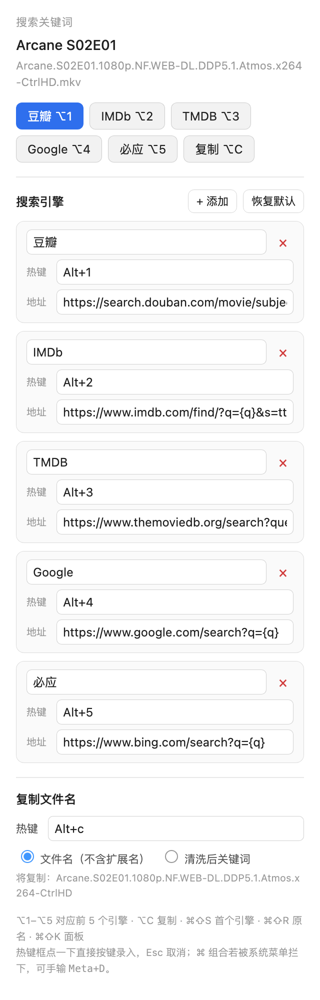
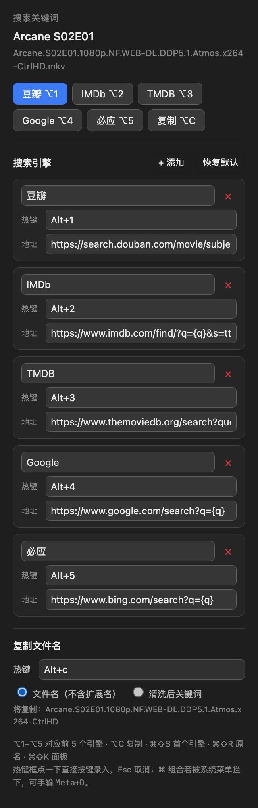

# Media Search — an IINA plugin

Search the file you're playing on Douban / IMDb / TMDB / Google / Bing — or any site you add — with a single keystroke.

[](LICENSE)
[](https://iina.io)
[](https://github.com/editwe/iina-media-search#requirements)

[中文说明](README.zh-CN.md)

It reads the current filename, strips the release noise (`1080p`, `WEB-DL`, `DDP5.1`, release groups…), and opens the search page of your chosen engine. If the hotkey you want is already taken, just press a new one: the panel records it.

| Light | Dark |
| --- | --- |
|  |  |

## Features

- **Filename cleaning** — removes resolution, source, codec, audio, release group and subtitle tags, keeps title / year / season-episode.
- **One-key search** — per-engine hotkeys, plus buttons in the sidebar panel.
- **Editable engine list** — add, rename, re-template or delete any engine, including the five built-ins. `{q}` is the keyword placeholder.
- **Recordable hotkeys** — click the hotkey field and press the combination. No need to remember the syntax, though manual input (`Meta+D`, `F2`, `Alt+3`) still works.
- **Copy filename without extension** — `Arcane.S02E01.1080p…mkv` becomes `Arcane.S02E01.1080p…`, ready to paste into a search box or a chat.
- **Instant updates** — changes in the panel rebuild the menu and the key bindings immediately, no restart.

## Requirements

- macOS 11 or later
- [IINA](https://iina.io) 1.4 or later (JavaScript plugin support)

## Install

IINA has no plugin-store install button for local builds, so copy the bundle:

```bash
git clone https://github.com/editwe/iina-media-search.git
cp -R iina-media-search/media-search.iinaplugin \
      "$HOME/Library/Application Support/com.colliderli.iina/plugins/"
```

No `git`? Grab the [source ZIP](https://github.com/editwe/iina-media-search/archive/refs/heads/main.zip), unzip it, and copy the `media-search.iinaplugin` folder to that same path.

Then:

1. Quit IINA completely and reopen it (plugins load at launch).
2. Open **Settings → Plugins**, find **Media Search** and switch it on.
3. Grant the requested permissions — `show-osd` (on-screen feedback) and `file-system` (writing to the clipboard goes through `osascript`, which IINA has no API for).

Play something, press **⌘⇧K**, and the panel appears in the sidebar.

## Default hotkeys

| Shortcut | Action |
| --- | --- |
| ⌥1 … ⌥5 | Douban / IMDb / TMDB / Google / Bing |
| ⌥C | Copy filename (without extension) |
| ⌘⇧S | Search with the first engine |
| ⌘⇧R | Search with the raw filename |
| ⌘⇧K | Open the panel |

The numbers follow the **order of the list**, so after deleting an engine the remaining ones shift up. Don't treat ⌥3 as a permanent identity — check the panel.

All of these are editable, including ⌥C.

## Recording a hotkey

1. Play something, press **⌘⇧K** to open the panel.
2. Click a hotkey field — it turns blue.
3. Press the combination, e.g. ⌥⇧3, ⌃⌥S or F5. Release to save.
4. Press **Esc** to cancel, or empty the field and press Delete to unbind.

Two limits worth knowing:

- **⌘ combinations may not be recordable.** macOS gives the app menu first refusal on ⌘ shortcuts, so the WebView never sees the key. Type it instead: `Meta+D` means ⌘⇧D.
- **A bare letter is not recorded** — it would be treated as normal typing. Use at least one of ⌃ ⌥ ⌘, or a function key.

Hotkeys also work while the panel itself has focus: the panel forwards them to the plugin.

## Hotkey syntax

Hotkeys are stored in mpv/IINA normal form:

| You type | Stored as | Meaning |
| --- | --- | --- |
| `cmd+shift+d`, `⌘⇧D` | `Meta+D` | ⌘⇧D |
| `opt+1`, `⌥1` | `Alt+1` | ⌥1 |
| `alt+c` | `Alt+c` | ⌥C |
| `ctrl+alt+del` | `Ctrl+Alt+DEL` | ⌃⌥⌦ |
| `F2` | `F2` | F2 |
| empty | — | not bound |

Modifier aliases: `Meta`/`Cmd`/`Command`/`⌘`, `Ctrl`/`Control`/`⌃`, `Alt`/`Option`/`Opt`/`⌥`, `Shift`/`⇧`.

Case matters: `Meta+d` is ⌘D, `Meta+D` is ⌘⇧D. Recording handles this for you.

Function keys can be bound and used, but macOS menu items cannot display them, so they only work while the player window is focused.

## Adding a search engine

Click **+ 添加**, then fill in:

- **Name** — what appears on the button.
- **URL template** — the search URL with `{q}` where the keyword goes, e.g.
  `https://search.douban.com/movie/subject_search?search_text={q}`
  If the template has no `{q}`, the keyword is appended to the end.
- **Hotkey** — optional.

**恢复默认** restores the five built-ins and asks for a second click first, so you don't lose a customised list by accident.

## Filename cleaning

```
Arcane.S02E01.1080p.NF.WEB-DL.DDP5.1.Atmos.x264-CtrlHD.mkv   →  Arcane S02E01
[电影天堂www.dy2018.com]流浪地球2.1080p.BD国语中字.mkv        →  流浪地球2
Spider-Man.No.Way.Home.2021.1080p.WEB-DL.mkv                →  Spider-Man No Way Home 2021
漫长的季节.第03集.1080p.mkv                                   →  漫长的季节 S1E03
```

Removed: resolution, source (`WEB-DL`/`BluRay`/`HDRip`), codec (`x264`/`HEVC`), audio (`DTS-HD MA`/`DDP5.1`/`Atmos`), release groups, language and subtitle markers.
Kept: title, year, season/episode. Hyphens inside titles (`Spider-Man`) survive — the trailing release group is only dropped when a release tag was actually present.

Both switches live in **Settings → Plugins → Media Search**: turn cleaning off to search the raw filename.

## Troubleshooting

**Nothing happens when I press a hotkey.**
Check that the plugin is enabled in **Settings → Plugins** and that both permissions are granted. A bare-letter hotkey is ignored by design — it needs ⌃ ⌥ ⌘ or a function key. Chords already claimed by macOS or another app never reach IINA.

**The panel is empty right after launch (fixed in 1.3.1).**
The sidebar WebView drops its message listener every time IINA loads the page, so the plugin was pushing data into a void. It now re-attaches after every load, and the panel asks for the state itself. If your panel is still empty, update to 1.3.1 and restart IINA once.

**⌘ hotkeys do nothing / can't be recorded.**
macOS reserves ⌘ chords for the app menu. Type the chord by hand (`Meta+D`) or pick an ⌥/⌃ combination.

**The search query is wrong.**
Turn off **去掉压制信息** in the plugin settings to search with the raw filename.

**Copy does nothing.**
The clipboard goes through `osascript`, which needs the `file-system` permission. Re-enable the plugin and grant it again.

**Reset everything.**
**恢复默认** in the panel restores the engine list. For a full reset, quit IINA and delete
`~/Library/Application Support/com.colliderli.iina/plugins/.preferences/com.example.iina-media-search.plist`.

## How it works

| Need | Approach |
| --- | --- |
| Current file | `mpv.getString("path")`, falling back to `core.status.title` for network streams |
| Opening a page | `utils.open(url)`; http(s) needs no extra permission |
| Menu items | `menu.item(title, action, { keyBinding })`, rebuilt on `iina.menu-update` |
| Key handling | `input.onKeyDown(key, cb, input.PRIORITY_HIGH)`, returning `true` stops the event before mpv sees it |
| Key normalisation | Mirrors `KeyCodeHelper.normalizeMpv`: modifier order `Ctrl+Alt+Shift+Meta`, shift+letter collapses to an uppercase letter |
| Recording keys | `event.code` (`Digit1`, `KeyC`) rather than `event.key` — on macOS ⌥1 yields `¡` in `event.key` |
| Clipboard | No clipboard API, so `utils.exec("/usr/bin/osascript", …)` — hence `file-system` |
| Panel IPC | `sidebar.postMessage` / `onMessage`, `window.iina.postMessage` / `onMessage` in the WebView |
| Panel reloads | `sidebar.loadFile` calls `messageHub.clearListeners()` at the end, so listeners must be re-attached *after* loading |
| Preferences | `preferences.set` followed by `sync()` |

## Repository layout

```
.
├── README.md                 this file
├── README.zh-CN.md           Chinese readme
├── LICENSE                   MIT
├── docs/images/              screenshots
└── media-search.iinaplugin/
    ├── Info.json             manifest: permissions, preference defaults, default engines
    ├── index.js              cleaning, engine storage, hotkeys, menu, clipboard, IPC
    ├── pref.html             settings page (IINA binds inputs via data-pref-key)
    └── ui/sidebar.html       sidebar panel: search buttons, engine editor, key recorder
```

## Changelog

**1.3.1**
- Fixed the panel showing nothing until **恢复默认** was clicked. `sidebar.loadFile()` clears the message hub's listeners when it finishes, so the panel was registering into a dead hub. Listeners are now attached after the load, the panel pulls the state itself on startup (with backoff retries), and any command from the panel marks it ready. Reloads are throttled to one per 3 s so the panel cannot erase itself in a loop.
- **恢复默认** no longer swallows a customised URL: the v3 migration back-fills each engine from its saved `url_<id>` preference.

**1.3.0**
- Fixed hotkeys being dead until the panel was opened or a setting was touched. Bindings are now registered at load and re-armed on `window-loaded` / `mpv-initialized` / `file-loaded`, and the menu is force-refreshed so its shortcuts exist before the menu is ever opened.
- Rebinding is incremental: a failure while registering one key no longer wipes the other bindings.
- Hotkeys now also fire while the sidebar panel has focus (the panel forwards them).
- Added diagnostics: the plugin logs the active key set (`热键已就绪: …`) on load.

**1.2.0**
- Hotkeys can be recorded by pressing keys in the panel.
- Defaults moved to ⌥1–⌥5 and ⌥C.
- Copy no longer includes the file extension, with a live preview in the panel.
- Key strings are normalised exactly like IINA, so the same chord written two ways is one chord.
- Added `input.onKeyDown` bindings (F1–F24 now work) and a recording mode that temporarily removes menu shortcuts.

**1.1.0** — engine add/delete/edit, per-engine hotkeys, copy filename.

## License

MIT. See [LICENSE](LICENSE).

Repository: <https://github.com/editwe/iina-media-search> — issues and pull requests are welcome.
