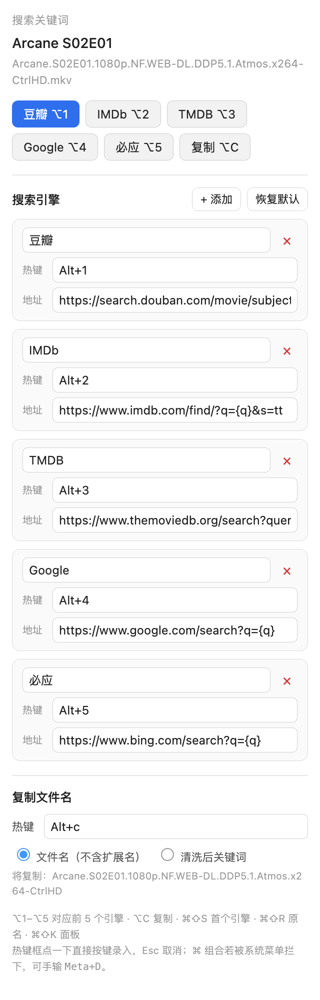
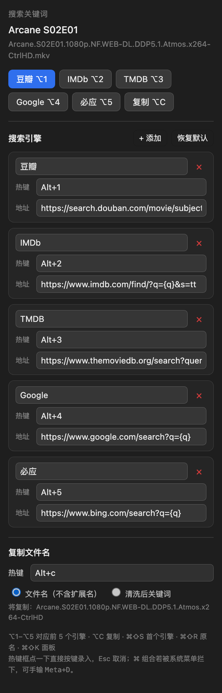

# Media Search — IINA 插件

播放视频时读取当前文件名，清洗后一键在豆瓣 / IMDb / TMDB / Google / 必应，或你自己添加的任意站点搜索。

[](LICENSE)
[](https://github.com/editwe/iina-media-search/releases/latest)
[](https://iina.io)
[](https://github.com/editwe/iina-media-search#环境要求)

[English](README.md)

文件名里的 `1080p`、`WEB-DL`、`DDP5.1`、发布组这些噪声会被自动剔除；热键想换就换——点一下热键框，直接按新组合键就录进去了。

| 浅色 | 深色 |
| --- | --- |
|  |  |

## 功能

- **中英双语界面** — 侧边栏面板、菜单、画面提示、设置页都跟着系统语言走：`zh-*` 用中文，其他语言一律英文。
- **文件名清洗** — 去掉分辨率、来源、编码、音轨、发布组、字幕标记，保留片名 / 年份 / 季集号。
- **一键搜索** — 每个引擎一个热键，面板里也有一排按钮。
- **引擎可增删改** — 包括内置的五个，全都能改能删。`{q}` 是关键词占位符。
- **热键可录入** — 点热键框直接按组合键，不用记语法；也可以手输 `Meta+D`、`F2`、`Alt+3`。
- **复制文件名不带扩展名** — `Arcane.S02E01.1080p…mkv` 复制出来是 `Arcane.S02E01.1080p…`，粘到搜索框或聊天窗口都干净。
- **改完立即生效** — 面板里改引擎或热键，菜单和按键监听当场重建，不用重启 IINA。

## 环境要求

- macOS 11 或更高版本
- [IINA](https://iina.io) 1.4 或更高版本（需要 JavaScript 插件支持）

## 安装

**在 IINA 里装（推荐）**：打开 **设置 → 插件 → 获取插件…**，粘贴

```
editwe/iina-media-search
```

确认即可。IINA 会优先从 latest release 取 `.iinaplgz`，取不到就下载 `main` 分支源码，以后还能帮你检查更新。

**用安装包**：下载 [`media-search-1.4.1.iinaplgz`](https://github.com/editwe/iina-media-search/releases/latest/download/media-search-1.4.1.iinaplgz)，双击它；或者走 **设置 → 插件 → 安装本地插件…** 选中这个文件。这个对话框只认 `.iinaplgz`，光是一个 `.iinaplugin` 文件夹是选不了的。

**手动复制**：插件文件就在仓库根目录，把这四个文件放进一个以 `.iinaplugin` 结尾的文件夹：

```bash
PLUGINS="$HOME/Library/Application Support/com.colliderli.iina/plugins"
git clone https://github.com/editwe/iina-media-search.git && cd iina-media-search
mkdir -p "$PLUGINS/media-search.iinaplugin/ui"
cp Info.json index.js pref.html "$PLUGINS/media-search.iinaplugin/"
cp ui/sidebar.html "$PLUGINS/media-search.iinaplugin/ui/"
```

然后：

1. **完全退出 IINA 再打开**（插件只在启动时加载）。
2. 打开 **设置 → 插件**，找到 **Media Search** 并启用。
3. 允许它申请的权限：`show-osd`（画面提示）和 `file-system`（写剪贴板要调用 `osascript`，IINA 没有剪贴板 API）。

播放任意视频，按 **⌘⇧K**，面板就在侧边栏里。

## 默认热键

| 快捷键 | 作用 |
| --- | --- |
| ⌥1 … ⌥5 | 豆瓣 / IMDb / TMDB / Google / 必应 |
| ⌥C | 复制文件名（不含扩展名） |
| ⌘⇧S | 用第一个引擎搜索 |
| ⌘⇧R | 用完整原始文件名搜索 |
| ⌘⇧K | 打开面板 |

数字跟着**列表顺序**走，删掉某个引擎后，后面的会往前顶。别把 ⌥3 当成永久身份，以面板显示为准。

这些都能改，包括 ⌥C。

## 录入热键

1. 播放任意视频，按 **⌘⇧K** 打开面板。
2. 点某个热键框，框会变蓝。
3. 直接按下组合键，比如 ⌥⇧3、⌃⌥S、F5，松手即保存。
4. 想放弃按 **Esc**；想解绑，清空输入框再按 Delete。

两个边界：

- **⌘ 组合可能录不进来**。macOS 会先让应用菜单处理 ⌘ 快捷键，WebView 收不到这次按键。这种情况直接手输：`Meta+D` 就是 ⌘⇧D。
- **单独按字母不会被录入**，否则会和正常打字冲突。热键至少要带 ⌃ ⌥ ⌘ 之一，或者用功能键。

面板自己有焦点时热键也有效——面板会把按键转发给插件。

## 热键写法

内部按 mpv/IINA 规范形式存储：

| 你输入 | 存成 | 含义 |
| --- | --- | --- |
| `cmd+shift+d`、`⌘⇧D` | `Meta+D` | ⌘⇧D |
| `opt+1`、`⌥1` | `Alt+1` | ⌥1 |
| `alt+c` | `Alt+c` | ⌥C |
| `ctrl+alt+del` | `Ctrl+Alt+DEL` | ⌃⌥⌦ |
| `F2` | `F2` | F2 |
| 留空 | — | 不绑定 |

修饰键别名：`Meta`/`Cmd`/`Command`/`⌘`、`Ctrl`/`Control`/`⌃`、`Alt`/`Option`/`Opt`/`⌥`、`Shift`/`⇧`。

**大小写是两个键**：`Meta+d` 是 ⌘D，`Meta+D` 是 ⌘⇧D。录入时会自动处理，手输时留意。

功能键（F1–F24）能绑也能用，但 macOS 菜单项无法显示功能键，所以只在播放器窗口聚焦时生效。

## 添加搜索引擎

点 **+ 添加**，然后填：

- **名称** — 按钮上显示的文字。
- **地址** — 搜索 URL，用 `{q}` 表示关键词位置，例如
  `https://search.douban.com/movie/subject_search?search_text={q}`
  模板里没有 `{q}` 时，关键词会拼到末尾。
- **热键** — 可留空。

**恢复默认** 会还原五个内置引擎，需要点两次确认，避免手滑丢掉自定义列表。

## 文件名清洗

```
Arcane.S02E01.1080p.NF.WEB-DL.DDP5.1.Atmos.x264-CtrlHD.mkv   →  Arcane S02E01
[电影天堂www.dy2018.com]流浪地球2.1080p.BD国语中字.mkv        →  流浪地球2
Spider-Man.No.Way.Home.2021.1080p.WEB-DL.mkv                →  Spider-Man No Way Home 2021
漫长的季节.第03集.1080p.mkv                                   →  漫长的季节 S1E03
```

剔除：分辨率、来源（`WEB-DL`/`BluRay`/`HDRip`）、编码（`x264`/`HEVC`）、音轨（`DTS-HD MA`/`DDP5.1`/`Atmos`）、发布组、语言与字幕标记。
保留：片名、年份、季集号。片名里的连字符（`Spider-Man`）不会被误伤——只有确实出现压制标签时才会处理末尾的发布组。

两个开关都在 **设置 → 插件 → Media Search** 里，关掉清洗就直接用原始文件名搜索。

## 常见问题

**按热键没反应。**
先确认插件在 **设置 → 插件** 里已启用、两个权限都给了。单独一个字母的热键会被忽略（要带 ⌃ ⌥ ⌘ 或功能键），被 macOS 或别的 App 占用的组合也到不了 IINA。

**打开播放器后面板是空的（1.3.1 已修）。**
侧边栏 WebView 每次加载页面都会把消息监听清掉，插件当时是往一个已经死掉的管道里推数据。现在每次加载后都会重新挂上监听，面板启动时也会自己来拉一次状态。如果你看到的还是空面板，升到 1.3.1 再重启一次 IINA。

**从 GitHub 安装时报「IINA 无法加载此插件，可能是格式错误」。**
这是 1.4.0 及更早版本的问题：插件放在子目录里，而 IINA 的源码兜底安装会在仓库根目录找 `Info.json`。1.4.1 已修好，重新安装一次，或者直接用最新 release 里的 `.iinaplgz`。

**⌘ 热键没反应 / 录不进去。**
⌘ 组合归应用菜单管。改成手输（`Meta+D`），或者换成 ⌥/⌃ 的组合。

**搜出来的关键词不对。**
把设置里的 **去掉压制信息** 关掉，用原始文件名搜。

**复制没反应。**
剪贴板走 `osascript`，需要 `file-system` 权限。重新启用插件并授权。

**我卸载了插件，为什么引擎列表还在？**
这是 IINA 的行为，不是插件自己留的。卸载走的是 `JavascriptPlugin.remove()`，只删插件目录；偏好存在另一个文件里，不跟着删，所以升级、重装都能接着用你的配置。数据全在这台机器上，明文在 `plugins/.preferences/com.example.iina-media-search.plist`。

**想全部重置。**
面板里的 **恢复默认** 只还原引擎列表。彻底清空：退出 IINA，删掉
`~/Library/Application Support/com.colliderli.iina/plugins/.preferences/com.example.iina-media-search.plist`。

## 隐私

插件只申请 `show-osd` 和 `file-system` 两个权限，**没有** `network-request` —— 没有这个权限，IINA 会直接拒绝 `iina.http`，插件本身发不出去任何东西。

真正离开应用范围的只有你主动触发的动作：`utils.open(url)` 把搜索地址交给浏览器，关键词（清洗后的文件名或剧集名）跟着这个 URL 到你点的那家站点。所以引擎选谁很关键；不想让原始文件名被搜，就关掉 **去掉压制信息**。复制走 `osascript`，结果是写进系统剪贴板，剪贴板工具照样能看到，和你复制别的东西一样。

## 实现要点

| 需求 | 做法 |
| --- | --- |
| 读当前文件 | `mpv.getString("path")`，网络流用 `core.status.title` 兜底 |
| 打开网页 | `utils.open(url)`，http(s) 不需要额外权限 |
| 菜单项 | `menu.item(title, action, { keyBinding })`，在 `iina.menu-update` 里重建 |
| 按键监听 | `input.onKeyDown(key, cb, input.PRIORITY_HIGH)`，回调返回 `true` 阻止事件传给 mpv |
| 键名归一化 | 对齐 `KeyCodeHelper.normalizeMpv`：顺序 `Ctrl+Alt+Shift+Meta`，Shift+字母收敛成大写字母 |
| 按键取值 | 用 `event.code`（`Digit1`、`KeyC`）而不是 `event.key`——macOS 上 ⌥1 的 `event.key` 是 `¡` |
| 写剪贴板 | 没有剪贴板 API，只能 `utils.exec("/usr/bin/osascript", …)`，所以需要 `file-system` |
| 面板通信 | `sidebar.postMessage` / `onMessage`，WebView 侧是 `window.iina.postMessage` / `onMessage` |
| 面板重载 | `sidebar.loadFile` 末尾会调 `messageHub.clearListeners()`，监听必须在加载**之后**再挂 |
| 偏好持久化 | `preferences.set` 之后必须 `sync()` |

## 仓库结构

```
.
├── README.md                 英文说明
├── README.zh-CN.md           本文件
├── LICENSE                   MIT
├── Info.json                 插件清单：权限、偏好默认值、默认引擎
├── index.js                  清洗、引擎存储、热键、菜单、剪贴板、面板 IPC
├── pref.html                 设置页（IINA 按 data-pref-key 自动读写）
├── ui/sidebar.html           侧边栏面板：搜索按钮、引擎编辑、按键录入
├── docs/images/              截图
└── tools/
    ├── build-package.sh      生成 media-search-<版本>.iinaplgz 和 .zip
    └── render-screenshots.py 重新生成上面四张截图
```

插件文件放在仓库根目录是有原因的：IINA 的「获取插件…」优先取 latest release 的 `.iinaplgz`，
取不到就退回 `archive/main.zip`，解压后执行 `mv */*`，所以 `Info.json` 必须在根目录。
放在子目录里就会报「IINA 无法加载此插件，可能是格式错误」。
`checkNewVersion()` 读的也是 `raw.githubusercontent.com/<repo>/main/Info.json`，同理。

## 更新日志

**1.4.1**
- 修复在 **设置 → 插件 → 获取插件…** 里输入 `editwe/iina-media-search` 安装时报「IINA 无法加载此插件，可能是格式错误」：插件原先放在 `media-search.iinaplugin/` 子目录，而 IINA 的源码兜底安装只把仓库解压后拍平一层，`Info.json` 就没落到它要找的位置。现在文件都在仓库根目录。
- 顺带修好了更新检查：`checkNewVersion()` 现在能读到 `main` 上的 `Info.json`，以前是 404。

**1.4.0**

- 有了英文界面。面板、菜单、画面提示、设置页都按系统语言选：插件侧用 `utils.preferredLocalizations()`，网页侧用 `navigator.language`，`zh-*` 走中文，其他一律英文。`Info.json` 加了 `localized` 段，IINA 里的插件简介也会跟着语言变。
- 内置引擎名跟着界面语言走：中文下是 豆瓣 / 必应，英文下是 Douban / Bing；你自己改过的名字不会被覆盖。
- 两份 README 各自配了对应语言的截图（同一套面板渲染出来的中英两版）。

**1.3.1**

- 修复「刚打开播放器面板是空的，点一下恢复默认才有数据」。原因是 `sidebar.loadFile()` 加载完会清空消息监听，面板把自己的监听挂进了一个已经死掉的 hub。现在改为加载后再挂监听，面板启动时主动拉取状态（带退避重试），面板发来的任何指令也会标记 ready；重载加了 3 秒节流，避免面板把自己刷成死循环。
- **恢复默认** 不再吞掉自定义地址：v3 迁移会用保存的 `url_<id>` 回填。

**1.3.0**

- 修复「刚启动时热键不生效，改一次设置才好」：绑定改为在插件加载时注册，并在 `window-loaded` / `mpv-initialized` / `file-loaded` 时补齐；同时主动 `forceUpdate` 菜单，让菜单快捷键不必等菜单被点开就存在。
- 重绑改为增量式：某个键注册失败不会再连带清空其它热键。
- 面板有焦点时热键也能用（由面板转发）。
- 增加诊断日志：加载时输出 `热键已就绪: …`。

**1.2.0**

- 热键支持按键录入。
- 默认热键改为 ⌥1–⌥5 与 ⌥C。
- 复制文件名不再带扩展名，面板里可预览。
- 键名按 IINA 规则归一化，同一组合的不同写法视为同一个键。
- 新增 `input.onKeyDown` 监听（F1–F24 可用），录制时临时摘掉菜单快捷键。

**1.1.0** — 引擎增删改、每个引擎独立热键、复制文件名。

## 许可证

MIT，见 [LICENSE](LICENSE)。

项目地址：<https://github.com/editwe/iina-media-search>，欢迎提 issue 和 PR。
